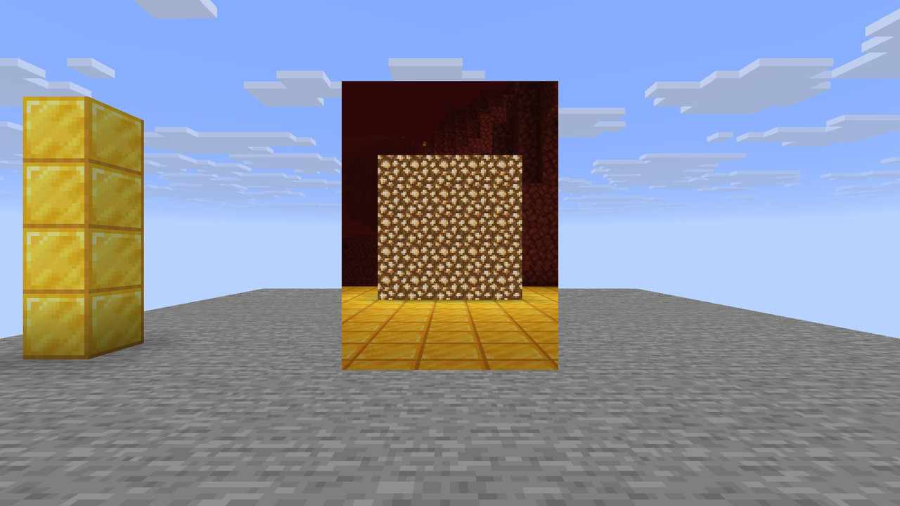
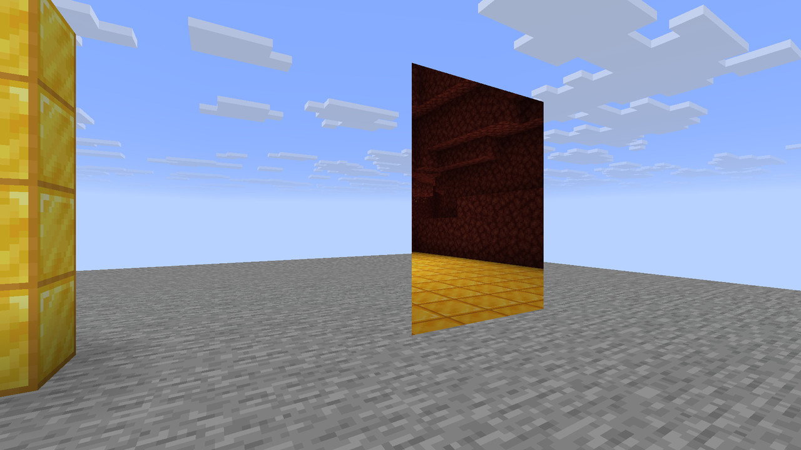
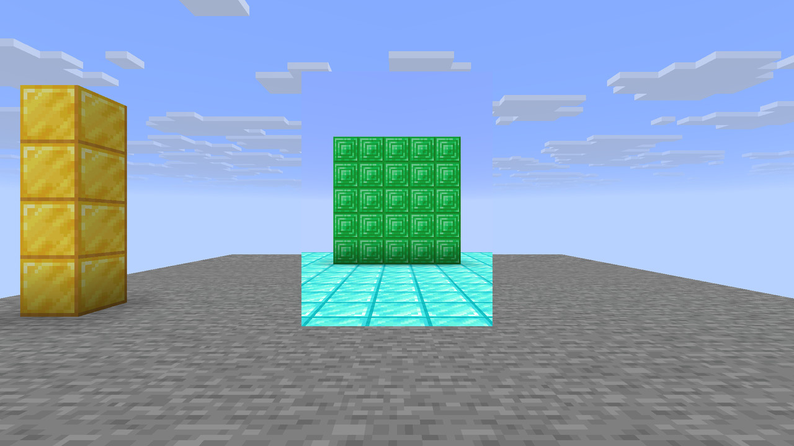
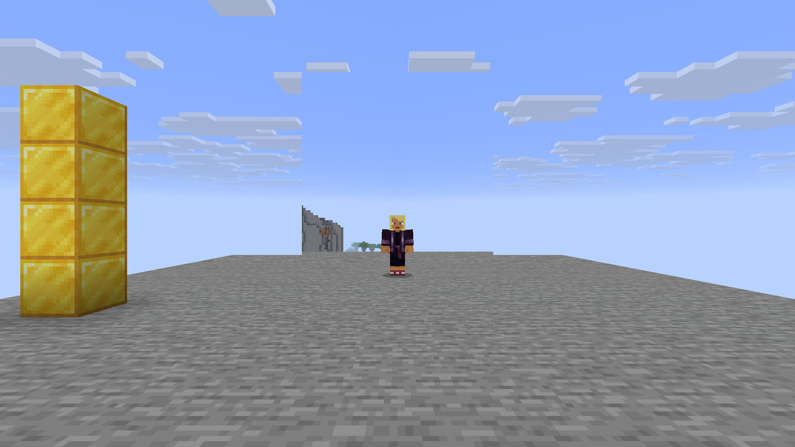
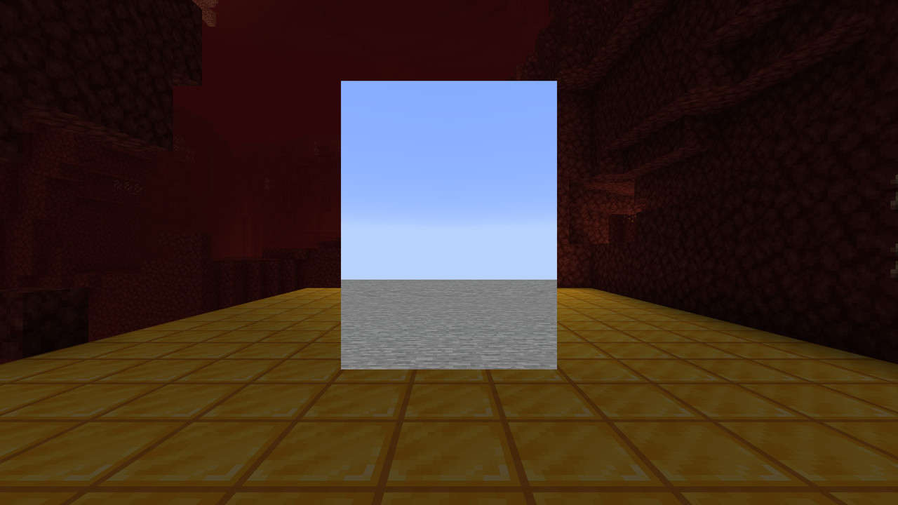
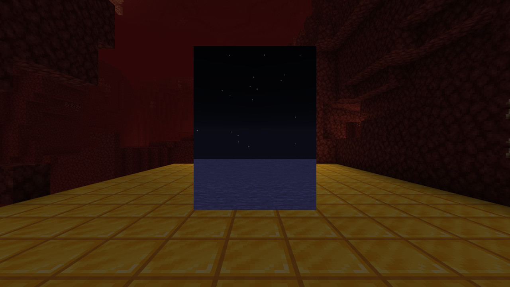

# Immersive Portals: Minecraft 26.3 fork (alpha)

Unofficial fork of [Immersive Portals](https://github.com/iPortalTeam/ImmersivePortalsMod), ported to Minecraft 26.3.

- Portal views use the Blaze3D/renderpearl API, so they run on both the Vulkan and OpenGL backends.
- Works with Sodium 0.9 (`mc26.3-0.9.3-beta.5`) or without it.
- Entities keep moving smoothly when they cross a portal instead of snapping forward.
- Each dimension seen through a portal uses its own lightmap, fog, and time of day.
- Each view is culled to the part of the screen its portal covers.

Requires Java 25, Fabric Loader 0.20+, and Fabric API 0.166+.

**Not working or not verified yet:** Iris is declared incompatible. Alternate dimensions and GUI portals are parked in `misc/`. Rotating-portal camera animation is not applied to the main view. Dedicated servers, real multiplayer, and nested portals have not been tested. Several far portals into one dimension share one renderer.

Automated in-game tests:

```
./gradlew runAutoTest -Pautotest=basic      # or crossing, lighting, occluded, benchmark
./gradlew runAutoTest -Penable_sodium=false # without Sodium
```

Results and screenshots are written to `run/imm_ptl_autotest/`. The graphics backend comes from `preferredGraphicsBackend` in `run/options.txt`.

## Screenshots

| | |
|---|---|
|  |  |
| Portal to the Nether | The same portal from an angle |
|  |  |
| Portal to a distant place in the same dimension | Mirror |
|  |  |
| The Overworld at noon, seen from the Nether | The same portal at midnight |

Captured in-game with Vulkan and Sodium by the automated test.

## FPS tests

Average FPS / 1% low FPS, median of 3 runs at 1920x1080:

| Scene | Vulkan + Sodium | OpenGL + Sodium | Vulkan | OpenGL |
|---|---:|---:|---:|---:|
| No portal (baseline) | 3,178 / 712 | 1,931 / 496 | 2,224 / 564 | 1,794 / 465 |
| Nether portal | 1,982 / 494 | 1,322 / 350 | 1,256 / 385 | 952 / 301 |
| Nether portal filling the screen | 1,799 / 486 | 1,228 / 371 | 695 / 274 | 578 / 217 |
| Far portal, same dimension | 1,943 / 523 | 1,355 / 386 | 1,178 / 379 | 880 / 299 |
| Mirror | 1,722 / 517 | 1,057 / 348 | 589 / 289 | 528 / 244 |

- **Hardware:** NVIDIA GeForce RTX 4070 Laptop GPU (driver 616.92), Intel Core i9-13900HX, 16 GB RAM.
- **Settings:** render distance 16, Fancy graphics, Sodium `mc26.3-0.9.3-beta.5`, vsync and frame limit off.
- **Method:** static camera, 10 seconds per scene, after a 30-second warm-up. The 1% low is the average FPS of the slowest 1% of frames.
- **Frames are rendered but not sent to the display**, so these numbers measure render throughput and will be higher than in normal play.
- The test world is a small, simple scene. Expect lower numbers in a real world.
- **This is not a comparison with the original mod.** The original does not run on Minecraft 26.3, so the claim that this fork is faster has not been measured.

Raw data: [`docs/benchmarks/results-mc26.3-7.0.0-alpha.1.csv`](docs/benchmarks/results-mc26.3-7.0.0-alpha.1.csv). To run it yourself:

```
./gradlew runAutoTest -Pautotest=benchmark -Pres=1920x1080 -Poffscreen
```

Results are written to `run/imm_ptl_autotest/benchmark.csv`. On laptops with two GPUs, check the `Using graphics device` log line, because OpenGL and Vulkan may pick different GPUs.

---

Update: this repo is not being maintained now. Forks are welcomed.

# Immersive Portals Mod

It's a Minecraft mod that provides see-through portals and seamless teleportation. It also can create "Non-Euclidean" (Uneuclidean) space effect.


[On CurseForge](https://www.curseforge.com/minecraft/mc-mods/immersive-portals-mod)     [On Modrinth](https://modrinth.com/mod/immersiveportals)     [Website](https://qouteall.fun/immptl/)

This mod changes a lot of underlying Minecraft mechanics. This mod allows the client to load multiple dimensions at the same time and synchronize remote world information(blocks/entities) to client. It can render portal-in-portals. The portal rendering is roughly compatible with some versions of Sodium and Iris. The portal can transform player scale and gravity direction.  [Implementation Details](https://qouteall.fun/immptl/wiki/Implementation-Details)

(This is the Fabric version of Immersive Portals. [The Forge version](https://github.com/iPortalTeam/ImmersivePortalsModForNeo))

## API

This mod also provides some API for:

* Manage see-through portals
* Dynamically add dimensions
* Synchronize remote chunks to client
* Render the world into GUI
* Other utilities

[API description](https://qouteall.fun/immptl/wiki/API-for-Other-Mods.html).

## How to run this code
https://fabricmc.net/wiki/tutorial:setup

## Other

[Wiki](https://qouteall.fun/immptl/wiki/)

[Discord Server](https://discord.gg/BZxgURK)

[Support qouteall on Patreon](https://www.patreon.com/qouteall)

